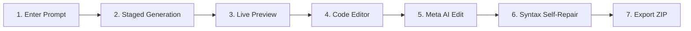
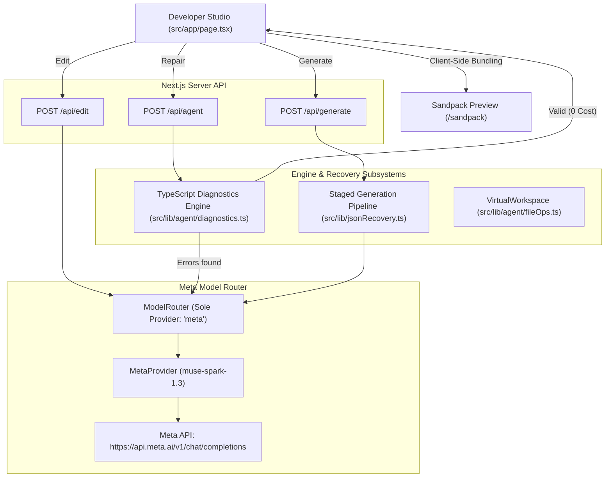

# Meta AI App Builder

> **Imagine it. Build it.**<br />
> A web application development studio powered exclusively by **Meta Muse Spark 1.3 (`muse-spark-1.3`)**. Transforms natural language descriptions into planned, modular, multi-file React TypeScript applications with live client-side preview, staged generation recovery, and compiler-guided syntax self-repair.

---

## 1. Problem Statement

Rapid application prototyping with Large Language Models typically suffers from three major pain points:

1. **Token Exhaustion & Truncation**: Multi-file code generation frequently exceeds output token limits, causing incomplete JSON responses, cut-off code, and lost progress.
2. **Disconnected Preview**: Most AI code tools display code snippets in chat without running them, forcing developers to manually set up projects, install dependencies, and troubleshoot bundler configs.
3. **Syntax Fragility**: Generated code often contains syntax defects (unclosed JSX tags, missing curly braces) that fail at compile time, requiring manual debugging before anything can be viewed.

---

## 2. Our Solution

**Meta AI App Builder** bridges the gap between natural language prompts and live running applications using a specialized Meta-powered architecture:

- **End-to-End Multi-File Generation**: Decomposes requests into planned modular architectures (`App.tsx`, shared types, modular UI components).
- **Muse Spark Truncation Recovery**: Detects output truncation (`finish_reason: "length"`), preserves completed files, and executes targeted Stage 4 continuations using compact requirements extraction.
- **Dedicated Live Application Preview**: Runs bundled React applications client-side in an isolated, preview-only Sandpack container powered by local `/sandpack` bundler assets.
- **Natural Language Workspace Edits**: Iteratively modifies existing code files via natural language instructions.
- **User-Triggered Syntax Self-Repair**: Uses the official TypeScript Compiler API (`ts.getSyntacticDiagnostics`) to detect syntax flaws and automatically repairs them with Meta Muse Spark in a bounded 2-attempt loop.

---

## 3. Key Features

- **Meta AI Visual Identity**: Modern dark theme inspired by Meta AI (`#0d0f12`, `#16161b`), animated 8-petal radial swirl emblem (`src/app/components/MetaEmblem.tsx`), and Meta Muse Spark status badge.
- **Hero & Prompt Composer**: Smooth rounded prompt composer card (`rounded-3xl`) with character counter, Enter-to-submit support, and circular Meta electric blue submit button.
- **Quick-Start Prompt Chips**: Curated prompt chips for Landing Pages, Analytics Dashboards, E-Commerce Stores, and Kanban Task Boards.
- **Visual Staged Progress Pipeline**: Real-time progress timeline tracking `Architecture Plan` → `Shared Types` → `UI Components` → `App Orchestrator` → `Validation & Repair`.
- **Preview-Only Sandpack Studio**: Displays solely the running application in the preview pane, eliminating internal code editor duplication.
- **In-Memory File Explorer & Code Editor**: Monospace editor with line counts, file-saving state, and syntax display.
- **Snapshot Undo / Redo**: 10-step workspace history for immediate rollbacks.
- **Project Store & ZIP Export**: Browser `localStorage` project management and one-click ZIP archive export via `jszip`.

---

## 4. How Meta Muse Spark 1.3 is Used

Meta Muse Spark 1.3 (`muse-spark-1.3`) is the **sole AI model** powering all AI operations:

| Subsystem | Endpoint | Prompting Strategy | Output Format |
| :--- | :--- | :--- | :--- |
| **Generation (Stages 1–4)** | `POST /api/generate` | Architectural planning, shared types, UI components, root orchestrator | Structured JSON files array |
| **Continuation (Stage 4 Recovery)** | `POST /api/generate` | Compact requirements representation, importing existing components | Orchestrator `App.tsx` |
| **Incremental Edit** | `POST /api/edit` | Contextual code diffing with user instruction | JSON `{ changedFiles, dependencies }` |
| **Syntax Self-Repair** | `POST /api/agent` | Targeted compiler diagnostic error context (line, col, snippet) | JSON `{ repairedFiles }` |

*For deep implementation details, see [docs/META_INTEGRATION.md](docs/META_INTEGRATION.md).*

---

## 5. Complete User Workflow



1. **Prompt**: Enter an application idea into the prompt composer or click a quick-start chip.
2. **Generation**: Meta Muse Spark plans the file manifest, generates shared interfaces, crafts UI components, and builds the root `App.tsx`.
3. **Live Preview**: The application immediately compiles and executes inside the live Sandpack preview iframe.
4. **Editor**: Inspect or manually edit generated source code across the file explorer.
5. **AI Editing**: Open the "✨ Meta AI Edit" drawer, enter an instruction (e.g., *"Add dark mode toggle in navbar"*), and click "Apply Changes".
6. **Syntax Self-Repair**: If a syntax issue occurs, click `"🛠️ Repair errors"` to invoke the TypeScript compiler-guided Meta repair loop.
7. **Export**: Save the project to the Projects Dashboard or download a production-ready ZIP archive.

---

## 6. Technology Stack

- **Framework**: Next.js 16.4.4 (App Router)
- **UI Library**: React 19.2.8
- **Language**: TypeScript 5.9.3 (strict mode)
- **Styling**: Tailwind CSS v4
- **Runtime Bundler**: `@codesandbox/sandpack-react` v2.20.0 (self-hosted local bundler assets)
- **Compiler Diagnostics**: TypeScript Compiler API (`ts.getSyntacticDiagnostics`)
- **Packaging & Export**: JSZip v3.10.1
- **AI Inference**: Meta API (`https://api.meta.ai/v1/chat/completions`) with Meta Muse Spark 1.3

---

## 7. Architecture Overview



*For comprehensive architecture documentation, see [docs/ARCHITECTURE.md](docs/ARCHITECTURE.md).*

---

## 8. Installation & Local Setup

### Prerequisites
- **Node.js**: `>= 20.9.0`
- **Package Manager**: `npm` (v9+ or v10+)
- **OS**: Windows, macOS, or Linux

### Quick Start

1. **Clone the repository:**
   ```bash
   git clone git@github.com:sagarummidi/meta-ai-app-builder-v2.git
   cd meta-ai-app-builder-v2
   ```

2. **Install dependencies:**
   ```bash
   npm install
   ```
   *(The postinstall script patches and copies Sandpack runtime assets into `public/sandpack` automatically)*.

3. **Configure environment:**
   ```bash
   cp .env.example .env.local
   ```
   Edit `.env.local` and add your Meta API key:
   ```ini
   AI_PROVIDER=meta
   MODEL_API_KEY=your_meta_api_key_here
   ```

4. **Start development server:**
   ```bash
   npm run dev
   ```
   Open [http://localhost:3000](http://localhost:3000) in your browser.

---

## 9. Environment Variables

| Variable | Required | Default | Description |
| :--- | :---: | :--- | :--- |
| `AI_PROVIDER` | No | `meta` | AI provider identifier (strictly `meta`) |
| `MODEL_API_KEY` | **Yes** | *None* | Server-side Meta API key for model authentication |
| `META_BASE_URL` | No | `https://api.meta.ai/v1` | Custom Meta API base URL override |
| `META_TIMEOUT_MS` | No | `600000` (10 min) | Upstream request timeout in milliseconds |
| `RATE_LIMIT_GENERATE_MAX` | No | `5` | Max generation requests per IP per window |
| `RATE_LIMIT_EDIT_MAX` | No | `10` | Max edit requests per IP per window |
| `RATE_LIMIT_AGENT_MAX` | No | `20` | Max syntax repair requests per IP per window |

---

## 10. Offline Quality & Verification Suite

All core systems include automated offline tests using deterministic mock providers and in-memory compiler harnesses. No external API credits are consumed during verification:

```bash
# 1. Run complete test suite (280 passing tests)
npm test

# 2. Strict project-wide TypeScript type check
npx tsc --noEmit

# 3. Code formatting and lint verification
npm run lint

# 4. Production Next.js build
npm run build

# 5. Git diff format validation
git diff --check
```

---

## 11. Screenshots

> *Screenshots can be placed in `docs/assets/screenshots/`.*

### Homepage & Prompt Composer

*Meta AI-inspired dark UI with animated swirl emblem, prompt composer, and quick-start prompt chips.*

### Developer Studio & Live Preview

*Three-column workspace: File Explorer (left), Code Editor & Meta AI Edit (center), Live Preview-Only Sandpack (right).*

---

## 12. Demo Video

[](https://www.youtube.com)
*Placeholder: Demo video walkthrough to be linked upon recording. Demonstrates prompt-to-app generation, live interactive preview, Meta AI natural language editing, and compiler-guided syntax repair.*

---

## 13. Known Limitations & Operational Notices

> [!WARNING]
> **Live Model Inference Connectivity Notice:**<br />
> Provider request routing, payload construction, secret sanitization, staged generation recovery, and endpoint boundaries are verified through an offline test suite (280 passing tests). End-to-end generation and repair against **live Meta API endpoints** (`https://api.meta.ai/v1/chat/completions`) have **not been executed**. A valid `MODEL_API_KEY` and active Meta API endpoint availability are required for live production operation.

> [!NOTE]
> **Client-Side Bundling Scope:**<br />
> Sandpack compiles React, TypeScript, CSS, and supported npm packages in-browser. Server-only features (e.g. database connections, raw Node.js OS binaries) are not executable within the client-side sandbox.

---

## 14. Future Scope

1. **Backend Database Mocking**: Provide in-browser SQLite / IndexedDB schemas for full CRUD data persistence in generated applications.
2. **One-Click Cloud Deployment**: Direct deployment connector to publish generated projects to hosting platforms.
3. **Component Theme Customizer**: Interactive palette and typography switchers for generated codebases.
4. **Visual Drag-and-Drop Stacking**: Visual canvas to arrange generated components directly inside the preview.

---

## 15. Hackathon Submission Summary

| Requirement | Implementation Status |
| :--- | :--- |
| **Sole AI Provider** | **Meta** (`meta`) |
| **Sole AI Model** | **Meta Muse Spark 1.3** (`muse-spark-1.3`) |
| **Other Providers** | Completely removed; zero fallback chains |
| **User Interface** | Meta AI-inspired dark theme, prompt composer, quick starts, studio workspace |
| **Live Preview** | Dedicated preview-only Sandpack container (no redundant code editor) |
| **Generation Resilience** | Staged pipeline, Muse Spark truncation recovery, bounded retries |
| **Syntax Self-Repair** | User-triggered TypeScript Compiler API diagnostics + bounded 2-attempt loop |
| **Verification** | 280 automated tests passing, 0 TypeScript errors, 0 ESLint warnings |

*For complete submission details, see [docs/SUBMISSION.md](docs/SUBMISSION.md).*
