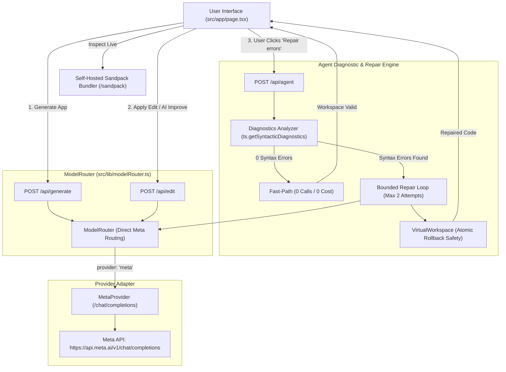

# AI App Builder

> **Meta-Only AI App Builder**<br />
> A browser-based React application builder featuring in-memory workspace editing, self-hosted Sandpack preview, and a user-triggered bounded TypeScript syntax self-repair agent with Meta provider routing (`muse-spark-1.3`).

---

## Important Verification & Operational Notices

> [!WARNING]
> **Live Model Inference Connectivity Unverified:**<br />
> Provider request routing, payload construction, secret sanitization, and endpoint boundaries are verified through an offline mock test suite. End-to-end generation and repair against **live Meta API endpoints** (`https://api.meta.ai/v1/chat/completions`) have **not been executed**. Do not assume the Meta endpoint or model is operational in production.

> [!WARNING]
> **Model Usage Costs & Credentials:**<br />
> The server expects `MODEL_API_KEY` configured in the server environment only. Never expose API keys to the browser client.

> [!NOTE]
> **Meta-Only Routing & Zero Cross-Provider Fallback:**<br />
> - **Workspace UI:** Defaults to **Meta (`muse-spark-1.3`)** in `src/app/page.tsx`.
> - **Server Routing:** All prompt generation, code editing, and syntax repair requests route directly to Meta (`muse-spark-1.3`) via `src/lib/modelRouter.ts`. Active Gemini, NVIDIA, and Nebius providers and cross-provider fallbacks have been removed.

---

## Overview & Intended Users

**AI App Builder** is a prototyping and code exploration environment for developers and designers. It provides:
1. **Scaffolding:** Natural language prompt-to-app code generation for multi-file React architectures.
2. **Workspace & Preview:** In-memory code editing paired with an isolated, client-side component preview.
3. **User-Triggered Syntax Self-Repair:** A manual diagnostic and repair workflow that checks for and repairs TypeScript/TSX syntax errors on demand.

---

## Implemented Features (Source-Verified)

### 1. In-Memory Workspace & Live Preview
- **Editable Source Code:** File tree navigation and live monospace editor in `src/app/page.tsx` supporting multi-file applications (`App.tsx`, `page.tsx`, etc.).
- **Self-Hosted Sandpack Preview:** Executes React TypeScript code client-side via `@codesandbox/sandpack-react` using local bundler assets served from `/sandpack`.
- **Virtual File Engine (`VirtualWorkspace`):** In-memory file operations (`create`, `update`, `delete`) in `src/lib/agent/fileOps.ts` with path traversal guards (rejecting `..` and leading slashes) and atomic rollback on multi-file mutation failures.
- **Undo / Redo History:** Maintains a 10-step snapshot stack (`pastSnapshots` / `futureSnapshots`) for immediate rollbacks.
- **Project Persistence & Export:** Stores projects in browser `localStorage` (`projectStore.ts`) and exports clean ZIP archives via `jszip`.

### 2. User-Triggered Bounded Syntax Self-Repair (`POST /api/agent`)
- **Explicit User Action:** Self-repair is **strictly user-triggered** via the `"🛠️ Repair errors"` toolbar action (or the `"🛠️ Repair with AI"` button inside `PreviewErrorBoundary`). It is **not** an automated interceptor that runs silently before rendering.
- **Zero-Cost Fast-Path:** If the workspace contains zero syntax errors, `/api/agent` detects this via the compiler API and returns immediately (`repaired: false`, `attempts: 0`) with zero model invocations and zero token cost.
- **TypeScript Compiler Diagnostics:** Analyzes in-memory TSX syntax using the official TypeScript Compiler API (`ts.getSyntacticDiagnostics`) in `src/lib/agent/diagnostics.ts` to locate unmatched tokens, unclosed JSX elements, and syntax errors.
- **Bounded Repair Loop:** Enforces a hard limit of **2 attempts** in `src/lib/agent/repairLoop.ts`, terminating early if no diagnostic progress is made.
- **Deterministic Workspace Fingerprinting:** Computes a normalized string digest of workspace paths and contents (`computeWorkspaceFingerprint` in `src/lib/agent/uiHelpers.ts`). If the user modifies code while an async repair is in flight, the response is rejected as stale to protect active edits.
- **Preview Error Boundary Shortcut:** When the preview encounters a host React render error, `PreviewErrorBoundary` surfaces a direct `"🛠️ Repair with AI"` shortcut.

---

## Meta AI Routing Architecture

### Provider Implementation (`src/lib/modelRouter.ts`)
The application implements `MetaProvider` to communicate with the Meta Chat Completions endpoint:
- **Base URL:** `https://api.meta.ai/v1` (customizable via `META_BASE_URL`)
- **Endpoint:** `POST https://api.meta.ai/v1/chat/completions`
- **Authentication:** `Authorization: Bearer ${MODEL_API_KEY}`
- **Payload:** Standard Chat Completions format (`model: "muse-spark-1.3"`, `messages: [{ role: "user", content }]`, `temperature`, `max_tokens`, `response_format: { type: "json_object" }`).
- **Secret Sanitization:** Redacts `MODEL_API_KEY`, Bearer tokens, and sensitive patterns from all client-facing error messages.

### Configured Models in `AVAILABLE_PROVIDERS`
| Provider ID | Display Name | Model Identifier | Role |
| :--- | :--- | :--- | :--- |
| `meta` | **Meta** | `muse-spark-1.3` | **Default Provider & Model** |

---

## Architectural Request Flow



---

## Prerequisites & Installation

### Prerequisites
- **Node.js:** `>= 20.9.0`
- **Package Manager:** `npm` (v9+ or v10+)
- **Operating System:** Windows, macOS, or Linux

### Setup Instructions

1. Configure environment variables:
   - **Windows PowerShell:**
     ```powershell
     Copy-Item .env.example .env.local
     ```
   - **macOS / Linux:**
     ```bash
     cp .env.example .env.local
     ```

2. Populate `.env.local` with your server-side key:
   ```ini
   AI_PROVIDER=meta
   MODEL_API_KEY=your_meta_api_key_here
   ```

3. Launch the local development server:
   ```bash
   npm run dev
   ```
   Access the web workspace at [http://localhost:3000](http://localhost:3000).

---

## Offline Testing & Quality Verification

All core subsystems include automated offline unit and integration tests using mocked fetch implementations to ensure zero external API costs:

```bash
# Run the complete test suite
npm test

# Run strict project-wide TypeScript type check
npx tsc --noEmit
```
