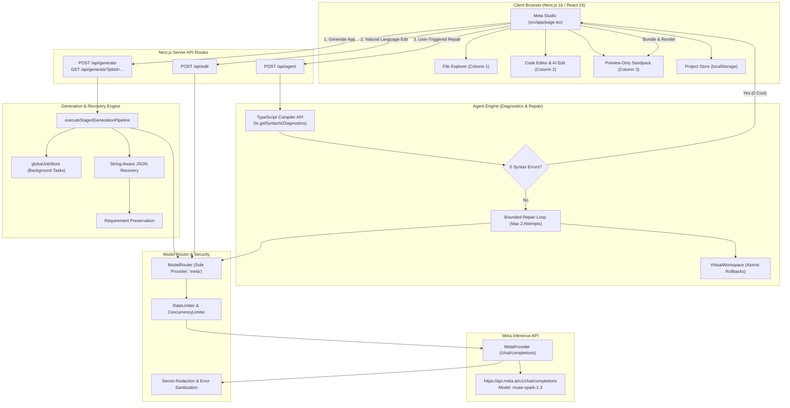

# Meta AI App Builder — Architecture & System Design

This document details the production architecture, request lifecycles, and component interactions of the **Meta AI App Builder**, designed and submitted for the Meta Hackathon.

---

## 1. Architectural Principles

1. **Meta-Only Provider Foundation**: All generation, natural language editing, and syntax self-repair operations route strictly to **Meta Muse Spark 1.3 (`muse-spark-1.3`)**. No secondary model fallbacks or alternative providers exist.
2. **Deterministic Workspace Resilience**: Long, complex application generations use a staged decomposition pipeline (`planning` → `generating_shared` → `generating_components` → `generating_entry` → `validating`). If token exhaustion occurs (`finish_reason: "length"`), completed files are preserved and continuations run against a shared aggregate deadline.
3. **Clean Studio Separation**: The developer studio separates concerns into three distinct columns: File Explorer, Code Editor & AI Edit, and a dedicated Preview-Only execution container.
4. **Zero External Runtime Dependencies**: Code preview runs entirely client-side inside an isolated iframe via self-hosted Sandpack assets (`/sandpack`), avoiding external bundler CDN latency or outages.

---

## 2. High-Level System Architecture

---

## 3. Frontend Architecture (`src/app/page.tsx`)

The frontend is a single-page studio application with three main view states:

### A. Homepage (Hero & Prompt Composer)
- **Visual Identity**: Inspired by Meta AI, featuring the 8-petal radial swirl emblem (`src/app/components/MetaEmblem.tsx`), soft ambient glow, and deep dark background (`#0d0f12`, `#16161b`).
- **Prompt Composer**: Large rounded card (`rounded-3xl`, `#1e1e23`) with Enter-to-submit, character counter, and circular Meta electric blue submit button.
- **Quick-Start Chips**: Curated prompt templates for Landing Pages, Analytics Dashboards, E-Commerce, and Task Management.
- **Real-Time Stage Indicator**: When generating, displays a 5-step visual pipeline (`Architecture Plan` → `Shared Types` → `UI Components` → `App Orchestrator` → `Validation & Repair`) with elapsed time counter and stage progress percentages.

### B. Developer Studio (Workspace)
Once an application is generated or loaded, the interface transitions into a three-column studio:
1. **Column 1 — File Explorer**:
   - Lists in-memory project files (`App.tsx`, `types.ts`, `components/*.tsx`).
   - Displays file type badges (`⚛️` TSX, `🔷` TS, `📄` CSS/config) and entry point highlight (`main`).
2. **Column 2 — AI Edit & Code Editor**:
   - **✨ Meta AI Edit**: Drawer allowing prompt-driven changes to the existing project files.
   - **Monospace Code Editor**: Live syntax viewer/editor with line counting, manual editing debounce timer (`manualEditTimerRef`), "Save Changes", and "Export ZIP" actions.
3. **Column 3 — Live Application Preview**:
   - **Preview-Only Configuration**: Composed via `@codesandbox/sandpack-react` using `SandpackProvider` + `SandpackLayout` + `SandpackPreview`. Sandpack's internal code editor is excluded to avoid UI clutter.
   - **Local Bundler**: Bundles code client-side via `/sandpack` local rewrite.
   - **PreviewErrorBoundary**: Traps React runtime exceptions and provides a direct `"🛠️ Repair with AI"` shortcut.

### C. Projects Dashboard
- Lists saved projects from browser `localStorage` (`src/lib/projectStore.ts`).
- Displays prompt summaries, timestamps, app type pills, and Open, Rename, Delete actions.

---

## 4. Backend Endpoints & Execution Paths

### 1. Staged Generation Endpoint (`POST /api/generate` & `GET /api/generate?jobId=...`)
- **Async Execution**: In production mode (`mode !== "sync"`), `POST /api/generate` spawns a background generation task in `globalJobStore` and returns HTTP 202 with a `jobId`.
- **Client Polling**: The frontend polls `GET /api/generate?jobId=...` every 1–2 seconds, receiving live `stageMessage` and `progressPercent` updates.
- **Decomposition Pipeline (`executeStagedGenerationPipeline`)**:
  1. **Stage 1 (Plan)**: Generates file manifest and module dependency graph.
  2. **Stage 2 (Shared Types)**: Generates `types.ts` and core interfaces.
  3. **Stage 3 (Components)**: Generates modular component files (`components/Header.tsx`, etc.).
  4. **Stage 4 (App Orchestrator)**: Generates root `App.tsx`, importing Stage 2 and Stage 3 artifacts.
  5. **Stage 5 (Validation & Auto-Repair)**: Runs syntax verification and repairs missing local imports.
- **Truncation Resilience (`src/lib/jsonRecovery.ts`)**:
  - Detects `finishReason: "length"` or incomplete JSON strings.
  - Extracts and preserves already completed files in `accumulatedFiles`.
  - Performs bounded Stage 4 retries using compact requirements representation (`promptSummary`), preserving requirements that appear late in long user prompts.
  - Honors a shared aggregate deadline (10 minutes total).

### 2. Natural Language Edit Endpoint (`POST /api/edit`)
- Accepts `instruction` and current workspace files.
- Validates that `provider === "meta"` and `model === "muse-spark-1.3"`.
- Requests structured JSON schema (`changedFiles` and `dependencies`).
- Merges modified files atomically into the workspace.

### 3. User-Triggered Syntax Self-Repair Endpoint (`POST /api/agent`)
- **User-Triggered**: Invoked only when the user clicks `"🛠️ Repair errors"` or `"🛠️ Repair with AI"`.
- **Fast-Path**: Runs `ts.getSyntacticDiagnostics` on virtual files. If zero syntax errors exist, returns immediately with 0 model calls and 0 token cost.
- **Diagnostic Loop (`runBoundedRepairLoop`)**:
  - Extracts file, line, column, error code, and code snippet.
  - Requests targeted repair from Meta Muse Spark.
  - Validates repaired files in `VirtualWorkspace`.
  - Terminates after a maximum of **2 attempts** or upon full syntax resolution.
  - Rolls back atomically if syntax does not improve.

---

## 5. Security & Isolation

- **Secret Redaction**: `sanitizeErrorMessage()` redacts API keys, Bearer tokens, and sensitive authorization patterns before returning errors to the browser.
- **Virtual File Guardrails**: `VirtualWorkspace` validates file paths, strictly rejecting path traversal (`..`), leading slashes, URL schemes, Windows drive letters, and UNC network paths.
- **Rate Limiting & Concurrency**: In-memory token bucket rate limiters prevent API flooding, and `ConcurrencyLimiter` throttles parallel model calls to Meta.
- **Sandboxed Execution**: Sandpack bundler operates inside an isolated iframe, preventing user-generated React scripts from accessing host application DOM or storage.
